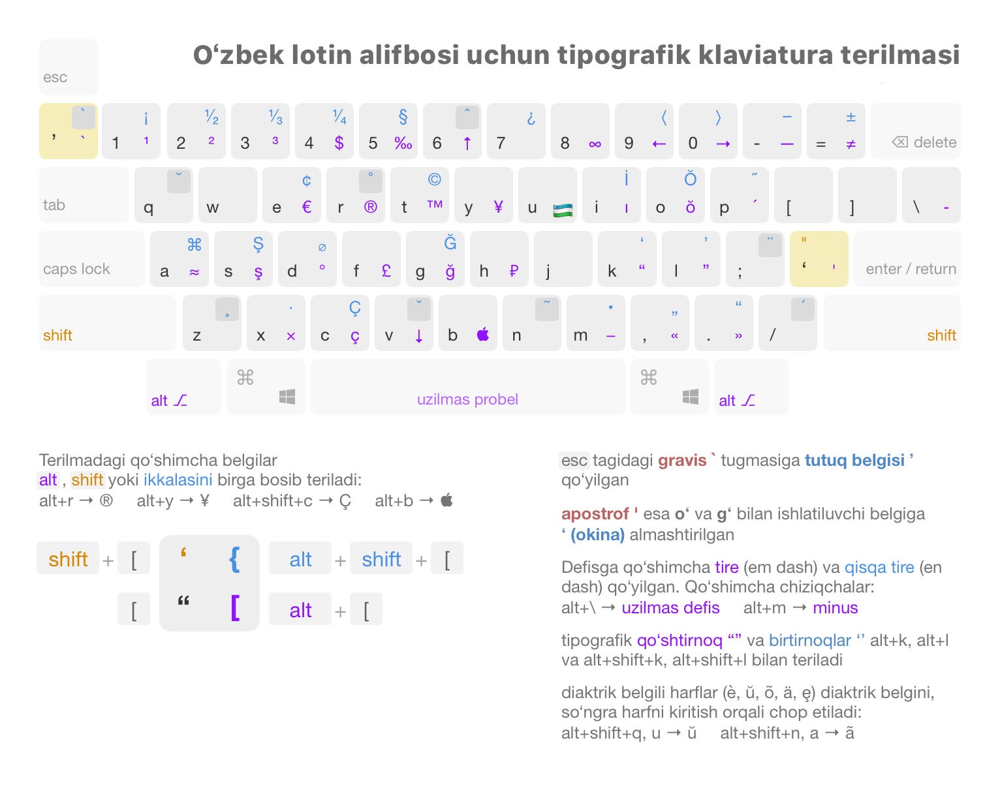
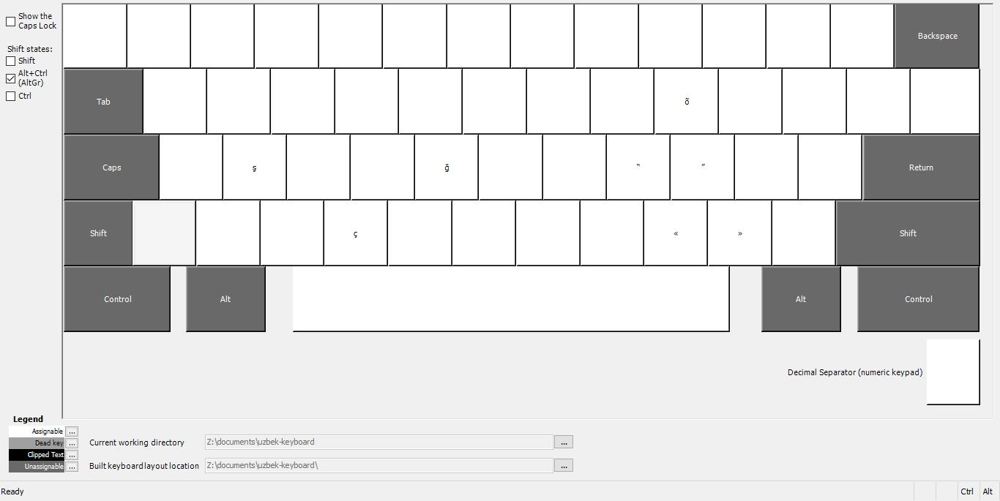
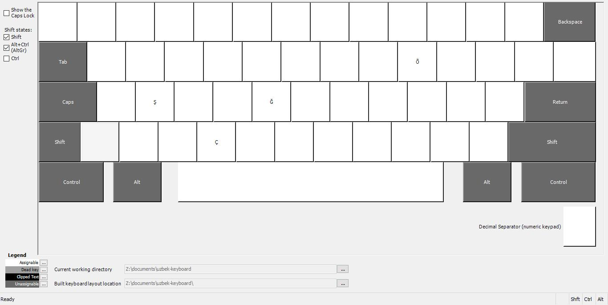

[Özbekça](README.md) | [English](README.en.md) 

# Linux va Windows uçun özbek klaviatura layouti

2023-yildagi alifbo yangilanişlarini va maxsus belgilarga tez kirişni özida jamlagan, tipografik jihatdan töğri özbek klaviatura layouti.

## Layoutlar

Bu paket beş xil Linux klaviatura layout variantini (hamda mos Windows layoutini, quyidagi [Windows](#windows) bölimiga qarang) taqdim etadi:

- **Uzbek (Standard):** Asosiy layout. Base va Shift qatlamlari oddiy US QWERTY klaviaturasi, yani hech narsani qayta örganişning hojati yöq.
  - `AltGr` özbekçaga xos **Ş, Ç, Ö, Õ, Ğ, İ** harflarini beradi.
  - `AltGr` + `` ` `` → **ʼ** (Modifier Apostrophe, U+02BC, _tutuq belgisi_)
  - `AltGr` + `'` → **ʻ** (Okina, U+02BB, _Oʻ/Gʻ_ da işlatiladi)
  - `AltGr` tipografik qöşimçalarga ham tez kiriş imkonini beradi: em/en tire, **« »** burçakli qöştirnoqlar, egri qöştirnoqlar, yuqori indekslar, valyuta belgilari va boşqalar.
- **Uzbek (US):** Tarixan alohida variant bölgan; hozir u yuqoridagi **Uzbek (Standard)** bilan funksional jihatdan bir xil, nomlar mos kelişi uçun saqlab qolingan.
- **Uzbek (2023):** 2023-yildagi alifbo yangilanişi taklifiga asoslangan. Bunda bir belgili harflarga bevosita (`AltGr` siz) kiriş mümkin:
  - `W` → **Ş/ş**
  - `[` → **Õ/õ**
  - `]` → **Ğ/ğ**
- **Uzbek (Programmer Dvorak):** Faqat Linux uçun. Base va Shift qatlamlari [Programmer Dvorak](https://www.kaufmann.no/roland/dvorak/) (`dvp`) layoutiga mos keladi, yani belgilar qatori va harflarning Dvorak'dagi joylaşuvi özgarmaydi. Özbekçaga xos harflar va tipografik qöşimçalar **Uzbek (Standard)** dagi kabi `AltGr` da joylaşgan.
- **Uzbek (Cyrillic):** Özbek klaviatura layoutining kirill varianti.


_**Uzbek (Standard)** layoutining batafsil körinişi. Binafşa rangli tugmalar `AltGr`, kök rangli tugmalar `Shift+AltGr` ni talab qiladi._

## Örnatiş

### Arch va Debian asosli Linux distributivlarida

1. Repozitoriyni klonlang:

```bash
git clone https://github.com/mirrrjr/uzbek-linux-and-windows-keyboard.git
cd uzbek-linux-and-windows-keyboard
```

2. Örnatiş skriptini işga tuşiring:

```bash
sudo ./install.sh
```

### NixOS

Bu repozitoriyni `flake.nix` faylingizga flake input sifatida qöşing:

```nix
# flake.nix
{
  inputs = {
    ...
    # Add this line to your inputs
    uzbek-keyboard.url = "github:mirrrjr/uzbek-linux-and-windows-keyboard";
  }

  outputs = {
    ...
    # Add this line to your outputs
    uzbek-keyboard,
  } @ inputs:
  {
    nixosConfigurations."nixos" = nixpkgs.lib.nixosSystem {
      modules = {
        ...
        # Add this line to your modules
        uzbek-keyboard.nixosModules.module
      }
    }
  }
}
```

Keyin taqdim etilgan layoutlarni `configuration.nix` fayliga qöşib işlatişingiz mümkin:

```nix
# configuration.nix
services.xserver.xkb.uz-enhanced.enable = true;
```


## Windows

Xuddi şu **Uzbek (Standard)** layoutining Windows versiyasi ham mavjud, u [Microsoft Keyboard Layout Creator](https://www.microsoft.com/en-us/download/details.aspx?id=102134) yordamida yaratilgan. U Linux layoutini aynan takrorlaydi: asosi oddiy US QWERTY, özbek harflari, punktuatsiya va tipografik qöşimçalar esa `AltGr` da.

> **Eslatma:** Programmer Dvorak varianti hozircha faqat Linux uçun mavjud.

| Base | Shift |
|---|---|
|  |  |

| AltGr | Shift + AltGr |
|---|---|
|  |  |

### Windows'da örnatiş

1. [Releases](https://github.com/mirrrjr/uzbek-linux-and-windows-keyboard/releases) sahifasiga ötib, eng oxirgi `setup.exe` ni yuklab oling.
2. Örnatuvçini işga tüşiring (Windows SmartScreen ogohlantirişi çiqişi mümkin, çünki örnatuvçi imzolanmagan. Bu kiçik, erkin tarqatiladigan vosita uçun normal holat; **More info → Run anyway** ni tanlang).
3. **Settings → Time & Language → Language & Region** ni oçing, tilingizni bosing → **Options**, keyin **Add a keyboard** ni bosib, **Uzbek (AltGr)** ni tanlang.
4. Taskbar'dagi til indikatori yoki `Win + Space` orqali unga almaşing.

## Foydalaniş

Örnatişdan keyin tizimdan çiqib, qayta kirişingiz kerak bölişi mümkin.

Keyin tizimingizning **Settings > Keyboard** (yoki **Input Sources**) bölimiga ötib, **"Uzbek"** ni qidiring va kerakli layout variantini qöşing (masalan, **Uzbek (Programmer Dvorak)**).

## Litsenziya

Bu loyiha MIT litsenziyasi ostida tarqatiladi. Batafsil ma'lumot uçun [LICENSE](LICENSE) fayliga qarang.

## Sinovdan ötkazilgan muhitlar

Bu loyiha quyidagilarda sinovdan ötkazilgan:

- **Arch Linux** — GNOME | Wayland
- **Debian 13** — GNOME, sway | Wayland
- **Windows 10/11**

Agar boşqa distributiv, desktop muhit yoki Windows versiyasida sinab körgan bölsangiz, issue yoki PR oçib, natijani bildiring.

## Minnatdorçilik

Bu loyiha [itsbilolbek/uzbek-linux-keyboard](https://github.com/itsbilolbek/uzbek-linux-keyboard) muallifining asl özbek XKB layouti asosida qurilgan. Katta rahmat, Bilolbek — asl lotin, 2023 va kirill layoutlarisiz bu loyiha bölmasdi!
